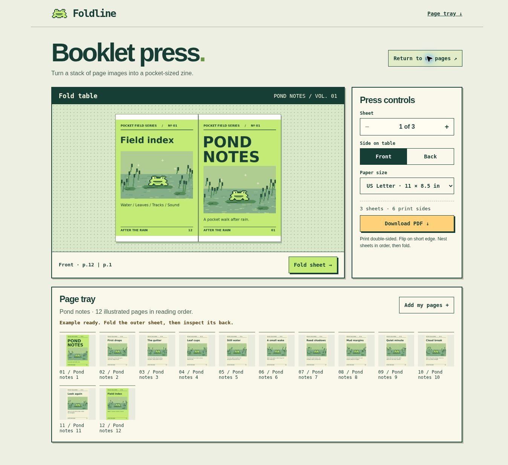

# Foldline

**Fold a virtual sheet. See where the pages go. Print a pocket zine.**



When a student has 12 illustrated pages for a class zine, they can put the pages into Foldline in reading order, check how the sheets fold, and walk away with a six-sided PDF ready to print on three sheets of A4.

## Try the fold

1. Select **Try an example** to open *Pond notes*, a pixel-art field guide to a walk after rain.
2. The outer sheet pairs page **12** with page **1**. Select **Fold sheet** to see the front cover. Select **Back** to open the reverse side, where pages **2** and **11** meet.
3. Step through the sheets with **+**. Choose **Download PDF** to export the entire booklet from any view.
4. In your PDF reader, print one PDF page per landscape sheet side, at actual size, double-sided with short-edge flipping. Leave the printer’s additional booklet and multiple-pages-per-sheet options off. Fold each sheet down the middle. Put sheet 2 inside sheet 1, then sheet 3 inside sheet 2. If your printer has hard margins, keep important artwork away from the paper edges.

## Use your own pages

Choose **Add my pages** and select JPEG or PNG files. The first import starts your own booklet. Further imports append to the same draft, including imports made while viewing the example. Check the tray order, move pages with the arrows, and use × to remove a page after confirmation. Every control works with the keyboard. The fold animation respects reduced-motion settings.

- One image per reading page, up to 32 pages and 12 MiB per image. Portrait images match the booklet shape most closely. Mixed aspect ratios are centered without cropping.
- Imported images are flattened onto white and resized to a maximum long edge of 1,800 pixels. Original files stay on your device.
- A batch is saved only after every image decodes. The page sequence and images are stored in IndexedDB after each successful edit. Reopen the same address in the same browser to restore them. Use one editing tab at a time. Clearing site data removes the draft. Keep the original images.
- Try the example at any time. **Return to my pages** brings the draft back. Extra slots at the end of reading order become blank pages.

## Run in VS Code

1. Extract the ZIP. In VS Code, choose **File → Open Folder** and select the folder containing this README and index.html.
2. With Python 3 installed, open **Terminal → New Terminal**. On Windows, run:

   ```powershell
   py -3 -m http.server 8000 --bind 127.0.0.1
   ```

   On macOS or Linux, run:

   ```sh
   python3 -m http.server 8000 --bind 127.0.0.1
   ```

3. Visit **http://127.0.0.1:8000/**. Keep the terminal open during the demo. Ctrl+C stops the server.
4. If you already use the VS Code Live Server extension, **Open with Live Server** on index.html also serves the project. Use the same server and port between sessions to access a saved draft.

The server only serves static files. All image processing and PDF creation run in the browser. All artwork and the PDF library are bundled locally.

## Deploy to GitHub Pages

1. Create a public repository named **foldline**. Upload the extracted project contents, including **assets**, **docs**, **js**, and **vendor**. Put **index.html** at the repository root. Commit to **main**.
2. Open **Settings → Pages**. Under **Build and deployment**, select **Deploy from a branch**, choose **main** and **/(root)**, and save.
3. When deployment completes, use **Visit site** in Pages settings. Add that URL to the repository’s **About → Website** field so a visitor can open the demo from the repository header.

[GitHub Pages publishing-source instructions](https://docs.github.com/en/pages/getting-started-with-github-pages/configuring-a-publishing-source-for-your-github-pages-site)

## Explain it in an interview

The page arrangement is called *imposition*. A folded sheet has four reading pages. Round the page count up to a multiple of four, then work inward from the first and last numbers. For 12 pages, the sequence is:

| Sheet from outside | Front, left / right | Back, left / right |
| --- | --- | --- |
| 1 | 12 / 1 | 2 / 11 |
| 2 | 10 / 3 | 4 / 9 |
| 3 | 8 / 5 | 6 / 7 |

Both the fold table and PDF exporter call the same **sheetPair** function. Changing the sheet view never changes reading order. CSS animates the fold, while the PDF contains flat print sides.

| File | What to show |
| --- | --- |
| index.html and style.css | Semantic controls, responsive layout and the fold transform |
| js/booklet.js | Page pairing, blank slots and proportional placement in a PDF |
| js/app.js | Image import, page tray actions, draft storage and export feedback |
| assets/ | Original pond illustrations, typeset pages and frog icon |
| vendor/ | Bundled pdf-lib 1.17.1 and its MIT license |
| docs/ | Project preview and verification report |

## Repository description

Fold a pixel-art zine in your browser, arrange your own page images, and export a double-sided booklet PDF for A4 or US Letter.

## 30-second demo script

“Why does page twelve sit next to page one? Watch what happens when I fold the sheet. Page one becomes the front cover, and twelve wraps around the back. Flip the sheet over and you get pages two and eleven. I can select my own illustrations in reading order, move a page, and download the whole booklet. This twelve-page guide takes just three sheets of A4.”

[Read the test report](docs/TESTS.md)
